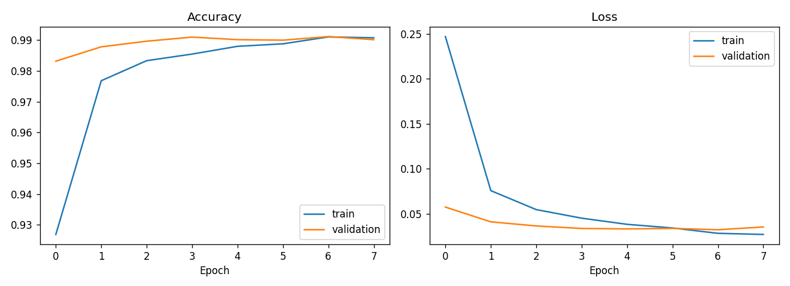
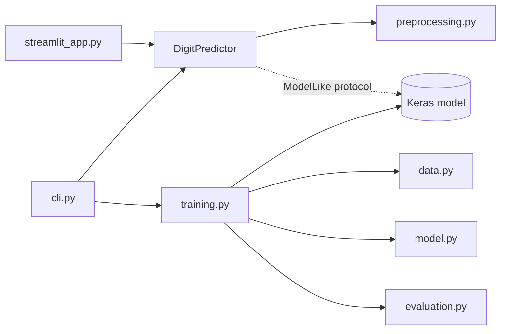

# ✍️ Handwritten Digit Recognizer

A CNN trained on MNIST, a reusable inference service, and a Streamlit app where you draw a digit and get a live prediction.

**Tech:** Python · TensorFlow/Keras · NumPy · Pillow · Matplotlib · scikit-learn · Streamlit · pytest



## Quick start
```bash
pip install -r requirements.txt
python -m digit_recognizer train            # trains and saves artifacts/mnist_cnn.keras
streamlit run streamlit_app.py              # draw-a-digit demo
python -m digit_recognizer predict my.png   # command-line prediction
pytest                                      # run the tests
```
**Test accuracy:** `XX.XX%` *(fill in after training)*

## Architecture

| Module | Responsibility | Depends on TensorFlow? |
|---|---|---|
| `config.py` | Constants and the immutable `TrainingConfig` | no |
| `preprocessing.py` | Image → MNIST-style array (6 small functions) | no |
| `predictor.py` | `DigitPredictor.predict(image) -> Prediction` | only to load a file |
| `data.py` / `model.py` / `training.py` / `evaluation.py` | Training pipeline, one concern per file | yes (lazy) |
| `cli.py`, `streamlit_app.py` | Thin interfaces, no business logic | no |

## Design decisions (and why)
- **Layered, UI-free core.** The same `DigitPredictor` serves the CLI and web app. Adding a REST API means writing one new file.
- **Dependency inversion.** `DigitPredictor` depends on a 1-method `ModelLike` protocol, not on Keras. Tests use a fake model, and the backend could be swapped for ONNX/TFLite without touching callers.
- **Preprocessing mirrors MNIST.** Crop → scale to 20px → centre by centre-of-mass. Without it, canvas drawings are frequently misclassified.
- **Immutable config dataclass.** Every hyper-parameter is in one place, and a run is reproducible (fixed seed).
- **Typed domain errors** (`BlankImageError`, `ModelNotFoundError`) are turned into friendly messages by the UI/CLI instead of stack traces.
- **Lazy TensorFlow imports.** Importing the package is instant and CI can test logic without installing TF.
- **Frozen dataclasses for results** (`Prediction`, `EvaluationReport`) prevent accidental mutation and document the return shape.

## Extending it
| I want to… | Change only |
|---|---|
| Try a different architecture | `model.py` |
| Change epochs, dropout, paths | `config.py` |
| Add augmentation | `data.py` |
| Serve over HTTP | add `api.py` that calls `DigitPredictor` |
| Use another model runtime | any object with `predict(x, verbose)` |
